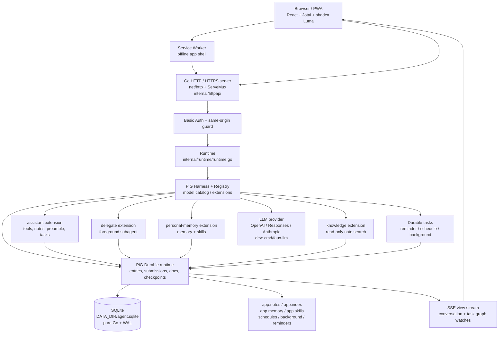

# Architecture: agent loop, context, and persistence

This document describes how the current Go implementation actually works. Code references point to the files that implement each step.

## 1. How the agent loop is started

### Process startup

1. `cmd/pida/main.go` parses the CLI. `pida serve` loads `~/.pida/pida.env` when present, applies flag overrides, and resolves the runtime configuration through `internal/config` (`config.go` plus `file.go` for the env-style file), then starts the HTTP/HTTPS listeners.
2. `runtime.Open` (`internal/runtime/runtime.go`) creates the runtime:
   - `internal/settings.Open` opens `DATA_DIR/agent.sqlite`, applies pending app migrations, and loads the active row from `app_llm_profiles`. Model configuration is only stored in SQLite; there is no LLM environment-variable path. New databases seed one default profile.
   - `createModels` builds a PiG `ai.Models` catalog with one provider (`demo`) from the stored settings. Supported wire protocols are `openai-completions`, `openai-responses`, and `anthropic-messages`. `Runtime.ApplyLLM` replaces that provider in place when the user saves settings, so no restart is needed.
   - `node.OpenNodeSqliteStorage(DATA_DIR/agent.sqlite, ...)` opens the durable store.
   - `harness.CreateRegistry()` installs four extensions: `tools.Assistant`, `tools.Delegate`, `personal.Extension`, and `knowledge.Extension`.
   - `harness.OpenHarness(ctx, storage, options)` creates the durable harness with those models and the registry.
   - `harness.Root(...)` opens the reserved root conversation, which holds session-scoped documents.
   - A commit increments the `app.meta` boot counter and records `lastBootAt`.
   - `harness.Resume()` enables scheduling and re-arms unfinished tasks from storage.
3. `httpapi.NewServer` creates the `net/http` handler tree and the shared task-graph watch. The server then begins accepting requests.

The application does **not** implement its own conversation loop. PiG's durable harness owns the generation task; this project supplies the provider, tools, prompt sections, documents, and task definitions.

### Per-message loop

1. The browser POSTs JSON to `/api/conversations/{id}/messages`.
2. `Server.postMessage` (`internal/httpapi/conversations.go`) parses attachments, builds model content, and calls:
   ```go
   conversation.Submit(ctx, durable.SubmissionDraft{
       Type: durable.SubmissionTypeInput,
       Content: attachments.BuildUserContent(text, files),
       RequestId: requestID,
       WhenBusy: followUpOrSteer,
   })
   ```
   The client receives `202 Accepted` with a submission ID immediately.
3. PiG admits the submission, appends a `pi.user` entry, and starts a durable generation task. That task repeatedly:
   - renders the model context (active transcript + prompt sections + tool declarations),
   - calls the configured model provider,
   - executes tool calls through the registry,
   - commits tool results into the same conversation,
   - continues until the model stops with a final assistant message.
4. The final assistant message is stored as a `pi.assistant` entry. The `pi.live` document clears, so `busy` becomes false.
5. Browser updates arrive over SSE from `GET /api/conversations/{id}/events`. The handler watches the conversation view and the task graph, coalesces changes with a 150ms debounce, and emits:
   ```
   event: view
   data: <simplified JSON payload>
   ```
   `simplifyView` builds the payload from entries, notes, reminders, subagents, tasks, usage, and parent links.

### Development provider

In dev, `pnpm dev` starts air with `DEV=1` and `HTTP_MODE=https` (self-signed TLS on `0.0.0.0:3111`). `pnpm dev:demo` additionally starts `cmd/faux-llm` first, waits for it on `127.0.0.1:18789`, then starts air, and points the dev server at it. The faux server is a standalone OpenAI-compatible HTTP service outside the main binary. Its script emits: three `todo` additions, `wait_seconds(10)`, three todo completions, then `Demo task complete.` The main binary only knows the normal `openai-completions` provider.

## 2. How context is managed

Context is assembled by the PiG harness from the registry and the conversation's durable documents. The four installed extensions supply:

### Tools

Registered in `internal/tools`, `internal/personal`, and `internal/knowledge`:

| Tool | Source | Purpose |
| --- | --- | --- |
| `todo`, `memo` | `internal/tools/tools.go` | maintain the per-conversation notebook |
| `current_time` | `internal/tools/tools.go` | current Beijing time |
| `fetch_page` | `internal/netutil/fetch.go` | SSRF-safe public page fetch |
| `wait_seconds` | `internal/tools/tools.go` | durable wait with a memoized deadline |
| `remind_me` | `internal/tools/tools.go` + `internal/tasks` | create a durable reminder task |
| `delegate` | `internal/tools/tools.go` | foreground subagent in a task-owned child conversation |
| `propose_memory`, `propose_skill`, `read_skill` | `internal/personal/personal.go` | approval-gated cross-session memory and skills |
| `search_knowledge`, `read_knowledge` | `internal/knowledge/knowledge.go` | read-only allowlisted note search |

All general-purpose tools are marked `Replay: durable.ReplaySafe`. Tool writes happen inside `api.Commit(...)`, so results and document changes are stored in the same durable transaction.

### Prompt sections

- `preamble` (`tools.Assistant`): concise English behavior instructions, including how to use todo, wait, reminders, delegation, scheduled tasks, memory, skills, knowledge, and web fetch.
- `notes` (`tools.Assistant`): renders `docs.Notes` todos and memos from a conversation snapshot.
- `memory` (`personal.Extension`): renders approved long-term memories from `app.memory`, up to a character budget. Skills are **not** dumped into the prompt: the agent calls `read_skill` to load an approved skill's full body on demand.
- Knowledge is accessed only through `search_knowledge` / `read_knowledge`; nothing is injected automatically.

### Idempotency and long-running work

- `todo`, `memo`, `remind_me`, and memory/skill proposals use a call ID or `requestId` stored in each document's `applied` map. Replaying a step therefore does not duplicate its effect.
- `wait_seconds` stores its deadline with `api.MemoCandidate("deadline", ...)`; after a restart it waits only for the remaining time.
- Durable tasks in `internal/tasks/tasks.go`:
  - `app.reminder`: `sleep` → `fire`, then submits `[Reminder] ...` as a follow-up.
  - `app.v3.schedule`: `sleep` → `fire` → `deliver`, revalidates the schedule row, reschedules the next occurrence, and submits `[Scheduled task] ...`.
  - `app.v3.background`: creates a task-owned child conversation, waits for its answer, then submits `[Background task result] ...` to the parent.
- Task follow-ups carry stable request IDs (`reminder:<id>`, `schedule:<id>:<at>`, `background-result:<id>`) so a replay cannot produce duplicate messages.
- `delegate` creates a child conversation owned by the current task, removes the `Delegate` extension from the child via `harness.Configure`, submits the task, waits for the answer, and stores the delegation status.

## 3. How the conversation is persisted

### Storage engine

All durable state lives in one SQLite file: `DATA_DIR/agent.sqlite` (`/data/agent.sqlite` in Docker). PiG opens it with `modernc.org/sqlite` (pure Go, no cgo), WAL mode, `synchronous=NORMAL`, and a 5-second busy timeout. There is no external database server.

### Application tables and migrations

`internal/settings` opens the same database with its own `database/sql` connection (WAL allows both pools) for tables the app owns, currently `app_llm_config`: one row holding the UI-configured provider, base URL, API key (stored in the local database, never returned by the API), model ID, context window and max tokens.

Migrations are an ordered list in `internal/settings/store.go`, tracked in SQLite's `user_version`. Each step runs in a transaction that also records the version, so an interrupted step is retried on the next start. A database written by a newer build is refused rather than downgraded. Add new steps at the end; never edit a shipped one.

### Durable records

PiG stores these record families in SQLite:

- **Entries**: immutable transcript events such as `pi.user`, `pi.assistant`, `pi.tool-result`, and head markers.
- **Submissions**: admitted input requests with request IDs and settlement state.
- **Tasks**: durable state machines with input, checkpoint, memos, and owner/conversation links.
- **Documents**: JSON values identified by kind and scope, with revision history according to their semantics.

### Application documents

Defined in `internal/docs/docs.go` and `internal/personal/personal.go`:

| Document | Scope | History / fork | Contents |
| --- | --- | --- | --- |
| `app.meta` | session | none | boot count, last boot time |
| `app.index` | session | none | conversation menu list, parent/child map |
| `app.v3.parents` | session | none | child conversation to parent map |
| `app.notes` | conversation | rewindable / as-of | todos, memos, applied call IDs |
| `app.reminders` | conversation | latest / initial | reminder rows and applied call IDs |
| `app.delegations` | conversation | latest / initial | foreground subagent rows |
| `app.v3.schedules` | conversation | latest / initial | schedule rows and applied request IDs |
| `app.v3.background` | conversation | latest / initial | background job rows |
| `app.memory` | session | none | approved/pending memory candidates |
| `app.skills` | session | none | approved/pending skill candidates |

`app.notes` being `rewindable` with `ForkAsOf` means a fork inherits the notebook as it existed at the fork point. The task/reminder documents use `HistoryLatest` with `ForkInitial`, so a fork starts them empty.

### Recovery and restart

- `harness.Resume()` after every process start re-arms scheduled tasks; sleeping tasks keep their original deadline in a durable checkpoint.
- The boot counter in `app.meta` is incremented on every start, which is visible in `/api/info` and the UI.
- `POST /api/crash` exits the process (outside production unless explicitly enabled) to demonstrate that work resumes from SQLite after a supervisor restart.
- Conversation creation, fork, message submission, tool results, and management actions all go through Durable transactions, so a crash cannot leave half-applied state.
- Request IDs on submissions and call IDs inside tool documents make retries and replays converge on the same stored result.

## 4. System diagram



## 5. Key source map

| Concern | File |
| --- | --- |
| Process start, CLI, and listener modes | `cmd/pida/main.go`, `cmd/pida/cmd_config.go`, `cmd/pida/cmd_service.go`, `internal/config/config.go`, `internal/config/file.go`, `internal/service/service.go` |
| Runtime bootstrap and harness | `internal/runtime/runtime.go` |
| Stored model settings, migrations, provider probe | `internal/settings/*` |
| Global settings dialog (Models / About tabs) | `web/src/components/SystemSettingsDialog.tsx` |
| HTTP routes, auth, SSE, static/PWA assets | `internal/httpapi/*`, `web/embed.go` (embedded `web/dist`) |
| Tool definitions and delegation | `internal/tools/tools.go` |
| Reminder/schedule/background tasks | `internal/tasks/tasks.go` |
| Persistent documents | `internal/docs/docs.go`, `internal/personal/personal.go` |
| Memory, skills, knowledge tools | `internal/personal`, `internal/knowledge` |
| Dev faux provider | `cmd/faux-llm/main.go`, `scripts/dev.mjs` |
